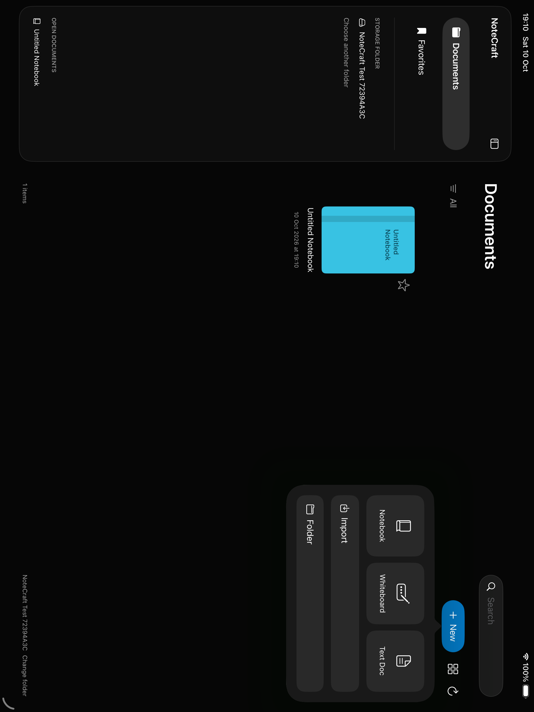
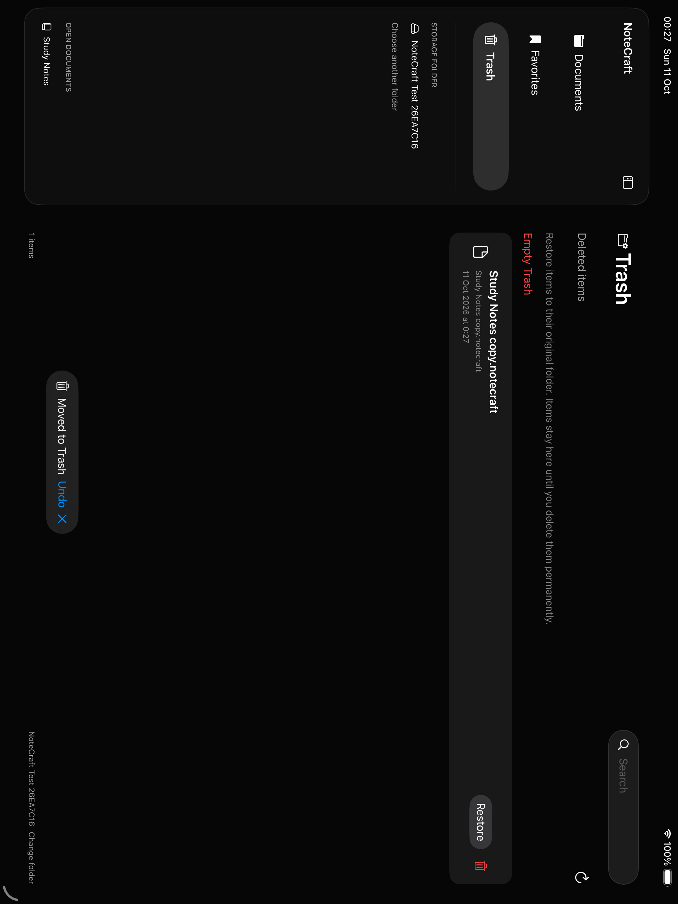

# NoteCraft

A clean-room native Swift notebook app for macOS and iPadOS. No third-party runtime
libraries, account system, proprietary cloud service, or AI features. Notes are portable
`.notecraft` packages, alongside ordinary PDFs and Markdown files. Choose a storage folder
on launch, including an existing Obsidian vault or a connected file provider.

## Build

Requires Xcode 16 or newer with Swift 6, macOS 14 / iPadOS 17 or newer.

- Open `NoteCraft.xcodeproj`, select the NoteCraft scheme and a Mac or iPad destination.
- To run on a physical device, choose your own signing team in Xcode.
- `swift test` runs core, rendering and vault integration tests on macOS.
- The `NoteCraft-iPad` scheme runs the folder-picker, drawing and whiteboard UI test on an iPad simulator.
- `swift run NoteCraft` runs the macOS app from the Swift package.
- Optional: `xcodegen generate` regenerates the checked-in project from `project.yml`.

## Workflow

On both Mac and iPad, choose a storage folder first. The Documents library shows the
folder's existing files and subfolders, with a dark sidebar, favorites, search, grid/list
views and document previews. Each item has a visible actions menu for rename, move,
duplicate and Move to Trash. Breadcrumbs navigate parent folders; sorting and grid/list
choice persist. Trash stores files and folders inside `.notecraft-trash` in the selected
vault. Restore returns an item to its original path and refuses to replace existing files.
Permanent deletion and Empty Trash have confirmation dialogs. Moving a PDF also moves
its editable sidecar; open sessions and favorites follow renamed/moved paths. New creates notebooks, whiteboards, Markdown documents or
folders in the current directory; Import copies files into that directory. A remembered
folder can be opened explicitly on the next launch. Connecting a vault does not import,
convert or rewrite its existing files.

Open PDFs to annotate the original file. Autosave writes standard PDF ink and text
annotations, preserving existing annotations. A hidden adjacent `.filename.pdf.notecraft`
package keeps the original background and editable NoteCraft objects; a SHA-256 digest
invalidates it if another app changes the PDF. Markdown edits save UTF-8 directly to the
original `.md` file, preserving wiki links as text. Markdown preview uses Apple's Markdown
renderer, rather than Obsidian-specific plugins. Opening an image creates a separate
editable notebook, preserving the image file.

By default only Apple Pencil draws; one finger scrolls notebooks or pans whiteboards.
Fingers still operate everything else: tap tools and objects, and drag an existing lasso selection (or its resize/rotate handles). Finger drawing can be enabled explicitly in the overflow menu. The first Pencil contact
restores Pencil-only ink; fingers then navigate. Pencil owns its active stroke, other contacts cannot replace it,
and scrolling/pinch gestures are suspended while the Pencil is down. Broad direct
contacts are filtered. Disable Apple Pencil only in the overflow menu to draw with fingers. Without Pencil-only mode, two fingers scroll while drawing; one finger scrolls in
read-only mode. Double-tap a supported Pencil to switch between the eraser and the previous
tool.

Draw a circle, ellipse, straight line or polygon and hold the tip still for about 0.45 seconds
to straighten it. Continue dragging before lifting to resize the shape; closed shapes retain
their center. Draw several broad zigzags over editable handwriting with the pen to erase it
in one undoable operation. Both gestures can be disabled in the overflow menu. The eraser
shows a live preview. Lasso handwriting, images and text, then drag inside the selection to
move the group with a live preview; release commits one undoable change.

In the default horizontal mode a swipe settles on exactly one page, and swiping past the last
page turns the blank page waiting there into a real one with the previous page's paper,
orientation and dimensions; undo removes it. At the bottom of a vertical notebook, pull upward
beyond the end and hold for a moment to append the same kind of page. In finger-drawing mode use
two fingers; with Pencil-only or read-only mode use one finger. On Mac, continue scrolling
downward at the end with the trackpad. The new page retains
the format but does not duplicate PDF content. Whiteboards support finger pan and two-finger
pinch zoom on iPad (pan uses two fingers unless Pencil-only mode is enabled), and trackpad scrolling/magnification on Mac. Whiteboard export fits the
content, including objects outside the initial page area. Open documents appear in the
workspace tab strip on both platforms. Changes autosave after a short pause and when
returning to the library. Failed saves keep changes in memory and show an error; concurrent
external changes are rejected instead of overwritten.

Select a toolbar tool; tap it again for settings. The pen supports fountain, ballpoint
and brush styles, pressure/tilt, custom colors, hex entry and three persistent thickness
presets. Erasure supports precision splits and whole strokes, with highlighter-only and
auto-deselect options. Highlighter ink renders beneath pen ink. Closed shapes support fill.
Lasso filters select handwriting, images and text, with cut/copy/paste, deletion, recoloring,
direct corner resize and rotation handles, cropped PNG export and a named reusable element
library. Elements preserve handwriting, images and rotated text across notebooks and vaults. Text boxes support font,
size, alignment, width, border and background; tap an existing box to edit it. Images can
be imported from Files or Photos, dropped as file URLs, moved, pinched and rotated.

The thumbnail button reveals pages and bookmarks; its context menu inserts, duplicates,
reorders and deletes pages. Horizontal navigation snaps to one page. The plus button opens paper templates.
Use the overflow menu for page direction, import, scan, paste, PDF forms and input settings.
Navigate document opens a page-number jump, bookmarks and a PDF table of contents.
PDF export retains outlines and remaps internal links after page reordering; links to
removed pages are disabled. Export current page creates a separate one-page PDF.
Fill PDF forms edits text fields, choices and checkboxes on the current page as an undoable
change. Read-only fields, radio buttons and signatures are not edited.
Password-protected PDFs prompt for a password and create an unlocked working PDF copy,
leaving the encrypted original unchanged. Passwords are not stored.
iPad scanning uses VisionKit on supported physical hardware. Read-only mode follows PDF
links. PDF import appends backgrounds with original dimensions; multi-page PDF export
retains vector ink, text and the original PDF backgrounds. Search covers text boxes and embedded PDF text, with page results and highlighted matches.

## Architecture

- **NoteCraftCore**: Codable, Sendable notebook/page/ink types, point transforms,
  bounded-depth quadtree, lasso, erasure, shape recognition, package codec and actor I/O.
- **NoteCraft**: SwiftUI folder library and observable document sessions, workspace and settings,
  UIKit/AppKit pointer bridge, shared CoreGraphics rendering and PDFKit import.
- **Tests**: Swift Testing coverage for package round trips and integrity, coordinate
  transforms, spatial queries, selection, erasure, concurrent conflict-safe writes,
  original PDF dimensions, searchable vector text, import and PNG rendering.

Coordinates are PDF points. Existing ink is cached in a CoreGraphics layer during input;
active samples render directly in a native view. iPad input consumes coalesced Pencil
samples with pressure and altitude. UI is main-actor isolated with Swift 6 concurrency
checking. See [the format specification](docs/FORMAT.md).

## Current boundaries

The app implements the local folder, notebook, whiteboard, PDF and Markdown workflow;
it does not yet provide every Goodnotes feature. There are no account, marketplace or
collaboration features. Undo history stays with each open document. Library search matches
filenames/titles; workspace search matches text boxes and embedded PDF text. Scanned pages
and handwriting are not searchable yet. See [the parity audit](docs/PARITY.md) for remaining work.

120 Hz is requested on supported iPads, but physical Pencil latency and palm rejection
still need device measurement. PDF rendering/export happens on the main actor and very
large documents need profiling. PDF saves and editable sidecars are separate coordinated
writes, not a single transaction; a mismatched sidecar is ignored on reopen. PDFs containing
images or filled shapes use a generated visual page with preserved native annotations.
Encrypted originals remain unchanged; editing uses an explicitly unlocked copy.
Advanced forms (including radio groups, signatures and scripted calculations), destinations
in unusual rotated PDFs with generated appearance pages and provider-specific conflict
recovery need further work. Simulator UI tests exercise folder selection, notebook creation,
finger drawing, erasing, undo, continued-page creation and reopening.
Automated tests also cover existing-file protection,
external-change detection, editable PDF round trips and canvas rendering.

## Contributing

Open an issue describing a reproducible problem or proposed feature. Keep changes small,
run `swift test`, and build both platform destinations. Preserve PDF-point coordinates,
package compatibility, native APIs and clean-room provenance. Explain non-obvious
engineering decisions in comments; avoid describing self-evident syntax. Contributions
must use original code and assets, without proprietary Goodnotes source or artwork.

## License

MIT. Goodnotes is a trademark of its respective owner. NoteCraft is independent and
is not affiliated with or endorsed by Goodnotes.
